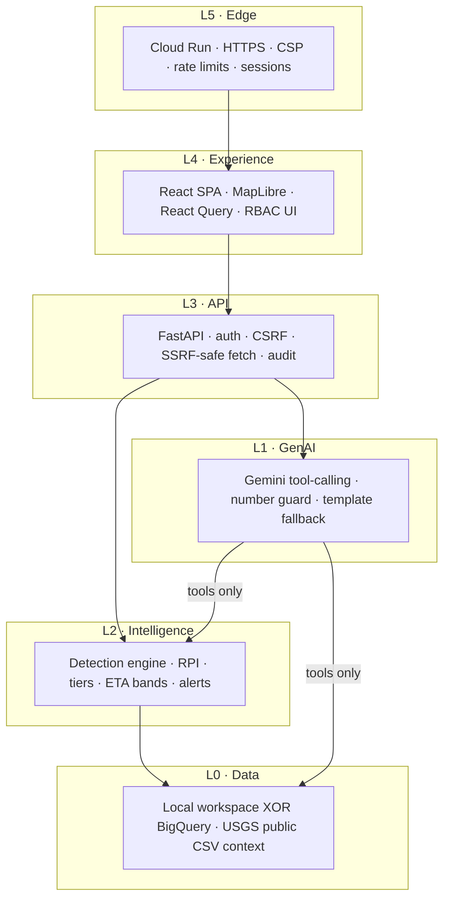

# TerraSentinel AI — layered architecture (architect view)

Companion to `TerraSentinel_Pitch_Deck.html` slides 03 (pipeline), 06 (layers), 07 (worked formulae).



## Detection pipeline (product)

1. **Ingest** — InSAR points + time series, rain, assets (validated)
2. **Locate** — 250 m chainage bins along corridor
3. **Measure** — speed, acceleration, progress, noise, seasonality
4. **Classify** — state + WEAK guard
5. **Rank** — RPI × tier
6. **Outlook** — ETA band from constant + accelerating regimes
7. **Explain** — Gemini + number guard

## Core formulae (engine — not LLM)

```
RPI = hazard × consequence × confidence   (0–100)

kin     = 100 × (0.4·speed_t + 0.3·accel_t + 0.3·prog_t)
hazard  = kin × (1 + 0.5 × rain_trigger/100)   # rain amplifies only
consequence = 0.5 + 0.5 × criticality
confidence  = 0.5 + 0.5 × confidence_score

ETA_const = remaining_mm / (rate_mm_month / 30)
ETA_accel = quadratic projection of current regime
band      = [min, max] of the two (with spread guard) — never a failure date
```

Worked demo path on slide 07: **NH-58 KM 3.25–3.50** → RPI 86 · band 35–64 days.

## Invariants

1. **GenAI never computes** risk, tier, or ETA. Tools return numbers; Gemini narrates; a guard rejects ungrounded figures.
2. **One API, two storage backends** (`local` | `bigquery`) — same detection maths.
3. **Public earthquakes are context** — never part of the risk score.
4. **Gemini API key ≠ BigQuery credential** — Vertex/BigQuery use ADC when org policy blocks SA keys.

## Screenshots

Live UI captures used in the deck live under `docs/pitch/shots/`.
